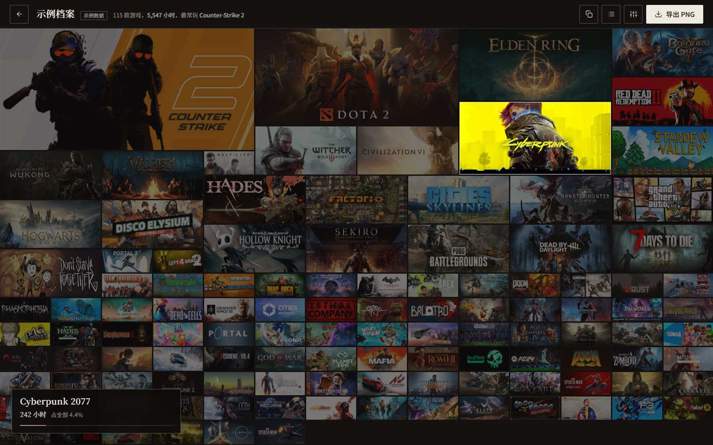
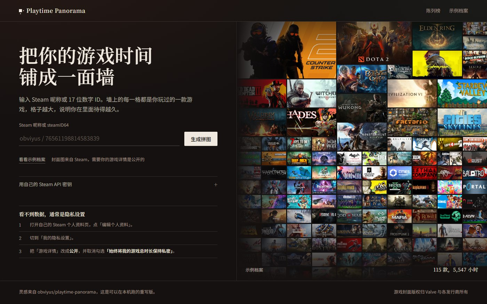

# Steam Playtime Wall · Playtime Panorama

Turn someone's Steam library into a wall: every game is a cover, and **each tile's area equals the time spent in that game**.
Export the whole wall as a PNG poster, optionally with the player's name, game count and total hours on a caption band.

English · [简体中文](README.md)





A zero-dependency Node service — no database, no build step, no `npm install`. Just `node server.mjs`.

- Spotlight hover: the wall dims, a wall label slides in with name / hours / share / last-two-week hours
- Covers are cached on the server and served instantly; ETag + versioned URLs so updates actually reach the browser
- Switch to a table view for exact hours
- Errors explain the next step: missing key / rejected key / private profile / Steam unreachable

## Quick start

Node 20+, nothing to install:

```bash
git clone <this-repo>
cd playtime-panorama
cp .env.example .env     # put your STEAM_API_KEY in it
node server.mjs
```

Open <http://127.0.0.1:8787>. `/demo` works without a key (bundled sample data).

> **Why is an API key required?**
> Since 2024 Steam requires a login to serve `/profiles/<id>/games`, so scraping a public library no longer works.
> Keys are free: [steamcommunity.com/dev/apikey](https://steamcommunity.com/dev/apikey).
> Resolving a vanity name to a steamID64 still works without a key.

## Deploy

`Dockerfile` and `docker-compose.yml` are included:

```bash
cp .env.example .env     # STEAM_API_KEY / HOST=0.0.0.0
docker compose up -d --build
```

Step-by-step instructions for the **1Panel** panel (upload, reverse proxy, HTTPS, common 502s) are in
[DEPLOY-1panel.md](DEPLOY-1panel.md) (Chinese).

## Configuration

All via environment variables, or a `.env` file in the project root (read by both `docker compose` and `node server.mjs`):

| Variable | Default | What it does |
|---|---|---|
| `PORT` | `8787` | Port |
| `HOST` | `127.0.0.1` | Bind address; use `0.0.0.0` behind Docker / a reverse proxy |
| `STEAM_API_KEY` | empty | Steam Web API key |
| `STEAM_API_KEYS` | empty | Comma-separated keys, rotated per request |
| `STEAM_PROXY` | auto-detect | HTTP proxy for Steam requests, e.g. `http://127.0.0.1:7890`; `off` forces direct |
| `STEAM_API_BASE` | `https://api.steampowered.com` | API base URL |
| `STEAM_COMMUNITY_BASE` | `https://steamcommunity.com` | Community base URL (vanity resolution) |
| `DEMO_STEAM_ID` | empty | Which account `/demo` shows; empty = bundled sample data |
| `COVER_SOURCE` | `auto` | `auto` first good image wins / `hashed` prefer the new hashed CDN path / `legacy` old path only |
| `CACHE_DIR` | `./data/cache` | Playtime cache directory |
| `COVER_DIR` | `./data/covers` | Cover cache directory |

The key can also be entered in the browser: it is stored in `localStorage` and sent to the local server as an
`X-Steam-API-Key` header, never written to disk on the server.

### Mainland China

`api.steampowered.com` and `steamcommunity.com` are usually unreachable directly from mainland China.
At startup the server probes common local proxy ports (7890 / 7897 / 1080 …) and uses the first one it finds:

```
Steam 代理：http://127.0.0.1:7890（本机 127.0.0.1:7890）
```

Or set `STEAM_PROXY=http://127.0.0.1:7890` explicitly, or `off` to force a direct connection.
Inside Docker, reach the host proxy via `http://host.docker.internal:7890` (compose already adds `host-gateway`).

### Why covers have two addresses

Games released after 2024 moved their header art from `cdn…/steam/apps/<id>/header.jpg` to
`shared.akamai…/store_item_assets/steam/apps/<id>/<hash>/header.jpg`, and the hash can only be read from AppInfo.
So the fetcher races the old path against "look up the hash → new path" and takes the first image that is
at least 4 KB (Steam returns a 1–2 KB grey placeholder for unreleased titles).
`COVER_SOURCE` changes that strategy.

## API

| Method | Path | Notes |
|---|---|---|
| GET | `/api/library/:identifier` | Vanity name or steamID64 → `{ steamID, displayName, games, fetchedAt, cached, stale }` |
| GET | `/api/health` | Version, build fingerprint, key configured, cover count, missing covers |
| GET | `/cover/:appid.jpg` | Cover image (cached on disk; ETag) |

`/api/library/:id?refresh=1` bypasses the cache; `X-Steam-API-Key` or `?api_key=` passes a one-off key.

## How the layout works

1. Sort by playtime, keep games with `playtime_forever > 0` (max 900).
2. Weight `w = (hours + 0.1) ^ 0.62`, normalize, then push through a `^1.35` curve to get each tile's target area.
3. Edge length `span = round(sqrt(1 + ratio^1.35 × (maxSpan² - 1)))`, clamped to `1..maxSpan` where
   `maxSpan = clamp(floor(columns / 6) + 3, 4, 12)`; the top three get an extra boost.
4. Row height is derived from the column width using the 460:215 header ratio, so an `span × span` tile is exactly
   the aspect ratio of Steam header art — covers never get distorted.
5. The column count is found by binary search: the smallest count that still fits one screen height, then reduced
   while it still fits, so tiles stay as large as possible; finally the row height is stretched to remove any
   leftover band at the bottom.
6. `grid-auto-flow: dense` backfills the holes left by big tiles with the 1×1 ones.

The PNG export redraws everything on a canvas with `object-fit: cover` maths and caps the longest edge at 8192 px.

## Layout of the repo

```
server.mjs                HTTP server, routes, page templating
lib/env.mjs               loads .env at startup
lib/http.mjs              one request path: proxied tunnel or direct
lib/steam.mjs             Steam API client
lib/store.mjs             playtime cache
lib/covers.mjs            cover cache (old path + hashed path)
public/index.html         home page
public/profile.html       the wall
public/404.html
public/assets/mosaic.js   the layout engine
public/assets/*.js        page logic
public/assets/style.css   design system
data/demo-library.json    bundled sample data
Dockerfile / docker-compose.yml
DEPLOY-1panel.md          1Panel deployment notes (Chinese)
.github/workflows/ci.yml  syntax check + smoke test
```

## Data & privacy

- Only the Steam ID goes to Steam (and to your own proxy, if configured). No third-party analytics.
- Caches live under `data/`: one JSON per profile, one JPG per appid. Delete the folder to reset.
- Playtime is cached for 15 minutes; if Steam is unreachable the server serves a cache up to 30 days old and says so.
- Game cover art belongs to Valve and the respective publishers; this project only displays it.

## Known limitations

- The target profile's game details must be public, otherwise Steam returns nothing (not a bug here).
- An API key is required to read the game list (see above).
- Some games (delisted, region-locked, unreleased) have no cover on Steam's side; they render as an initials card.

## Credits

The idea and the visual format are inspired by [obviyus/playtime-panorama](https://github.com/obviyus/playtime-panorama).
This is an independent rewrite: zero-dependency Node, local cover cache, proxy support and an optional export caption.

## License

[MIT](LICENSE)
