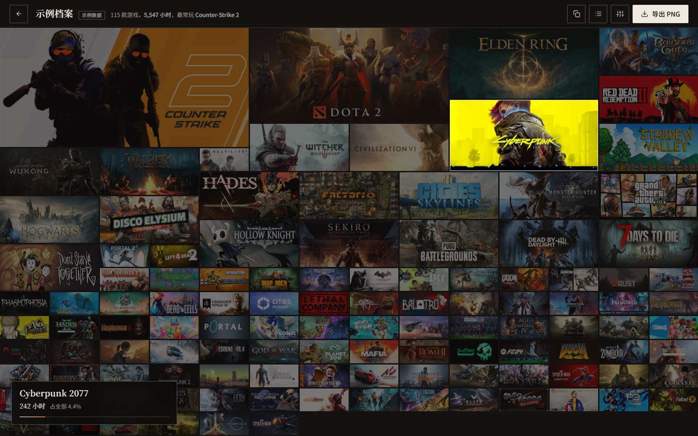
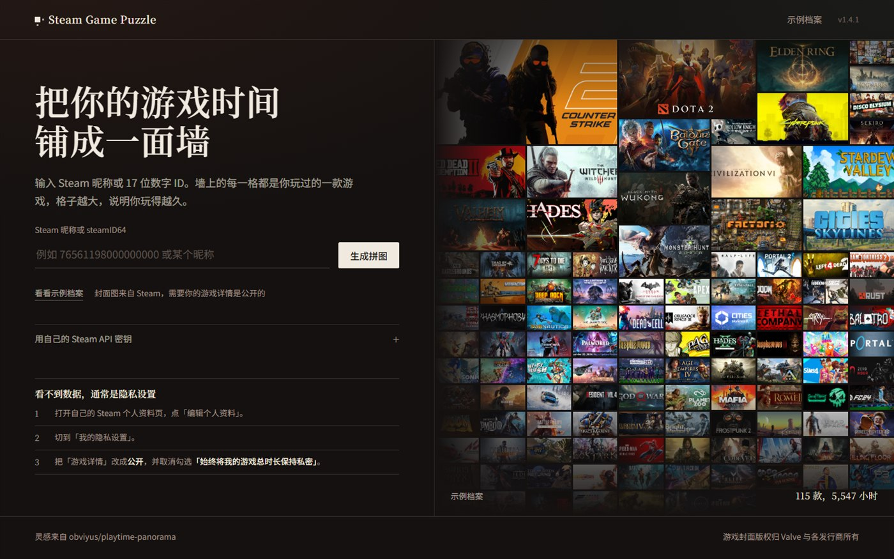

<div align="center">

# Steam Game Puzzle

**把一个人的 Steam 游戏库，铺成一面墙**

每款游戏一张封面，格子面积 = 你在那款游戏里花掉的时间。<br>
整面墙导出成 PNG 海报，可选带上名字、款数、总时长。

[](https://github.com/jike-ge/Steam-Game-Puzzle/actions/workflows/ci.yml)
[](LICENSE)


[English](README.en.md) · **简体中文**

<a href="docs/screenshot-wall.jpg"></a>

</div>

---

一个零依赖的纯 Node 服务：不用装包、不用数据库、不用构建，`node server.mjs` 就跑起来。
输入 Steam 昵称或 17 位 ID，它把整个库铺成一面墙；鼠标扫过，整面墙暗下来，左下角浮出这一格的「展签」。

| | |
|---|---|
| **面积即时长** | 权重 `(小时+0.1)^0.62`，再过一条 `^1.35` 的曲线，前三名额外抬一档 |
| **一屏铺满** | 列数二分到刚好填满视口，最后按真实行数补齐高度，底部不留黑边 |
| **聚光悬停** | 整面墙变暗，展签显示名称 / 时长 / 占比 / 近两周 |
| **封面本地缓存** | 服务器取一次存本地，同源直出，导出画布不会被跨域弄脏 |
| **中英双名** | 有中文名就显示成「English / 中文」，没有就只显示原名 |
| **清单视图** | 一键切成表格，看全部游戏和精确小时数 |
| **可选展签** | 导出 2 倍 PNG，底部可带用户名 / 游戏数 / 总时长 |
| **说人话的报错** | 没密钥 / 密钥被拒 / 私密资料 / 连不上 Steam，各给下一步 |

## 界面



## 跑起来

Node 20 以上，**不需要 `npm install`**：

```bash
git clone https://github.com/jike-ge/Steam-Game-Puzzle.git
cd Steam-Game-Puzzle
cp .env.example .env     # 填一个 STEAM_API_KEY
node server.mjs
```

打开 <http://127.0.0.1:8787>。不填密钥也能先看 `/demo` 自带的示例墙。

> [!IMPORTANT]
> **读游戏列表必须配 API 密钥。** Steam 从 2024 年起要求登录才能访问 `/profiles/<id>/games`，
> 免登录抓库的老办法已经失效了。密钥免费：[steamcommunity.com/dev/apikey](https://steamcommunity.com/dev/apikey)。
> 把昵称解析成 steamID64 仍然可以免密钥完成。

## 部署

`Dockerfile` 和 `docker-compose.yml` 都已备好：

```bash
cp .env.example .env     # STEAM_API_KEY / HOST=0.0.0.0
docker compose up -d --build
```

用 **1Panel 面板**部署的完整步骤（上传代码、反向代理、HTTPS、常见 502 排查）见
[DEPLOY-1panel.md](DEPLOY-1panel.md)。

## 配置

全部走环境变量，也可以写在项目根目录的 `.env` 里（`docker compose` 和 `node server.mjs` 都会读）：

| 变量 | 默认 | 作用 |
|---|---|---|
| `PORT` | `8787` | 端口 |
| `HOST` | `127.0.0.1` | 监听地址，容器 / 反代场景用 `0.0.0.0` |
| `STEAM_API_KEY` | 空 | Steam Web API 密钥 |
| `STEAM_API_KEYS` | 空 | 多个密钥逗号分隔，轮换使用 |
| `STEAM_PROXY` | 自动探测 | 拉 Steam 数据走的代理，如 `http://127.0.0.1:7890`；`off` 强制直连 |
| `STEAM_API_BASE` | `https://api.steampowered.com` | 接口地址 |
| `STEAM_COMMUNITY_BASE` | `https://steamcommunity.com` | 社区地址（昵称解析） |
| `DEMO_STEAM_ID` | 空 | `/demo` 用哪个账号；留空就用仓库自带的示例数据 |
| `COVER_SOURCE` | `auto` | 封面来源：`auto` 谁快用谁 / `hashed` 优先哈希路径 / `legacy` 只用老路径 |
| `CACHE_DIR` | `./data/cache` | 时长缓存目录 |
| `COVER_DIR` | `./data/covers` | 封面缓存目录 |

密钥也可以在前端填：存在浏览器 `localStorage`，随 `X-Steam-API-Key` 请求头发给本机服务器，不落盘。

## 两个踩过的坑

<details>
<summary><b>国内网络：Steam 连不上怎么办</b></summary>

`api.steampowered.com` 和 `steamcommunity.com` 在国内大多直连不通（域名能解析，TCP 直接超时）。
启动时会自动探测本机常见代理端口（7890 / 7897 / 1080 …），探测到就走它：

```text
Steam 代理：http://127.0.0.1:7890（本机 127.0.0.1:7890）
```

也可以显式指定 `STEAM_PROXY=http://127.0.0.1:7890`，或写 `off` 强制直连。
Docker 里连宿主机代理用 `http://host.docker.internal:7890`（compose 已加 `host-gateway`）。

</details>

<details>
<summary><b>封面：为什么有两套地址</b></summary>

2024 年之后的新游戏，封面从 `cdn…/steam/apps/<id>/header.jpg` 搬到了
`shared.akamai…/store_item_assets/steam/apps/<id>/<hash>/header.jpg`，哈希只能查 AppInfo 得到。

所以取图顺序是：老路径和「查哈希 → 新路径」**并发**，谁先给出 ≥4KB 的真图用谁。
Steam 对未上线的游戏会返回 1–2KB 的灰色占位图，用大小挡掉。`COVER_SOURCE` 可以改这个策略。

</details>

## 接口

三个都是 `GET`：

| 路径 | 说明 |
|---|---|
| `/api/library/:identifier` | 昵称或 steamID64，返回 `{ steamID, displayName, games, fetchedAt, cached, stale }` |
| `/api/health` | 版本 / 构建指纹 / 有没有密钥 / 缓存了多少封面 / 缺哪些封面 |
| `/cover/:appid.jpg` | 封面（本地有就直接给，没有就取一次存下来；带 ETag） |

`/api/library/:id?refresh=1` 绕过缓存重新拉；也可以带 `X-Steam-API-Key` 头或 `?api_key=` 用临时密钥。

## 版式算法

1. 按时长降序排，只保留 `playtime_forever > 0` 的游戏（最多 900 款）。
2. 权重 `w = (小时 + 0.1) ^ 0.62`，归一化后再过一条 `^1.35` 的曲线，得到每格的目标面积。
3. 边长 `span = round(sqrt(1 + ratio^1.35 × (maxSpan² - 1)))`，限制在 `1..maxSpan`，
   其中 `maxSpan = clamp(floor(列数/6) + 3, 4, 12)`；前三名额外抬一档。
4. 行高从列宽推出来（封面 460:215），所以 `span × span` 的格子正好是封面的比例，不会被拉变形。
5. 列数用二分查找：先找「能塞进一屏高度」的最小列数，再往回减，直到下一档塞不下——
   这样格子尽可能大；最后按剩余高度把行高补齐，底部不留黑边。
6. `grid-auto-flow: dense` 负责把 1×1 的小格子填进大格子留下的洞里。

导出的 PNG 用 canvas 重画一遍，每格按 `object-fit: cover` 的规则居中裁切，最长边限制 8192px。

## 目录

```text
server.mjs                HTTP 服务、路由、页面模板填充
lib/env.mjs               启动时读 .env（零依赖）
lib/http.mjs              统一取数：走代理隧道或直连
lib/steam.mjs             Steam 接口封装
lib/store.mjs             时长缓存
lib/covers.mjs            封面缓存（老路径 + 哈希路径）
public/index.html         首页
public/profile.html       游戏墙
public/404.html
public/assets/mosaic.js   拼图引擎（算法核心）
public/assets/*.js        各页面逻辑
public/assets/style.css   设计系统
data/demo-library.json    自带示例数据
Dockerfile / docker-compose.yml
DEPLOY-1panel.md          1Panel 部署步骤
.github/workflows/ci.yml  语法检查 + 起服务自检
```

## 数据与隐私

- 只把 Steam ID 发给 Steam（以及你自己配的代理），没有第三方统计。
- 缓存只在 `data/` 下：一个档案一个 JSON，封面一个 appid 一个 jpg，中文名在 `data/names.json`，删掉即重置。
- 时长缓存 15 分钟内不重复请求；Steam 挂了会退回 30 天内的旧缓存，并在页面上标明「这是缓存」。
- 游戏封面版权归 Valve 与各发行商所有，这里只做展示。

## 已知限制

- 目标账号的「游戏详情」必须是公开的，否则读不到时长（Steam 侧限制，不是 bug）。
- 读游戏列表必须配 API 密钥（见上）。
- 部分游戏（下架、区域限制、未上线）在 Steam 侧就没有封面，会显示首字母占位卡。

## 致谢

玩法与版式参考了 [obviyus/playtime-panorama](https://github.com/obviyus/playtime-panorama)。
本项目是独立重写：零依赖 Node 实现、封面本地缓存、代理支持、可选的导出展签。

## License

[MIT](LICENSE) · 封面版权归 Valve 与各发行商所有
